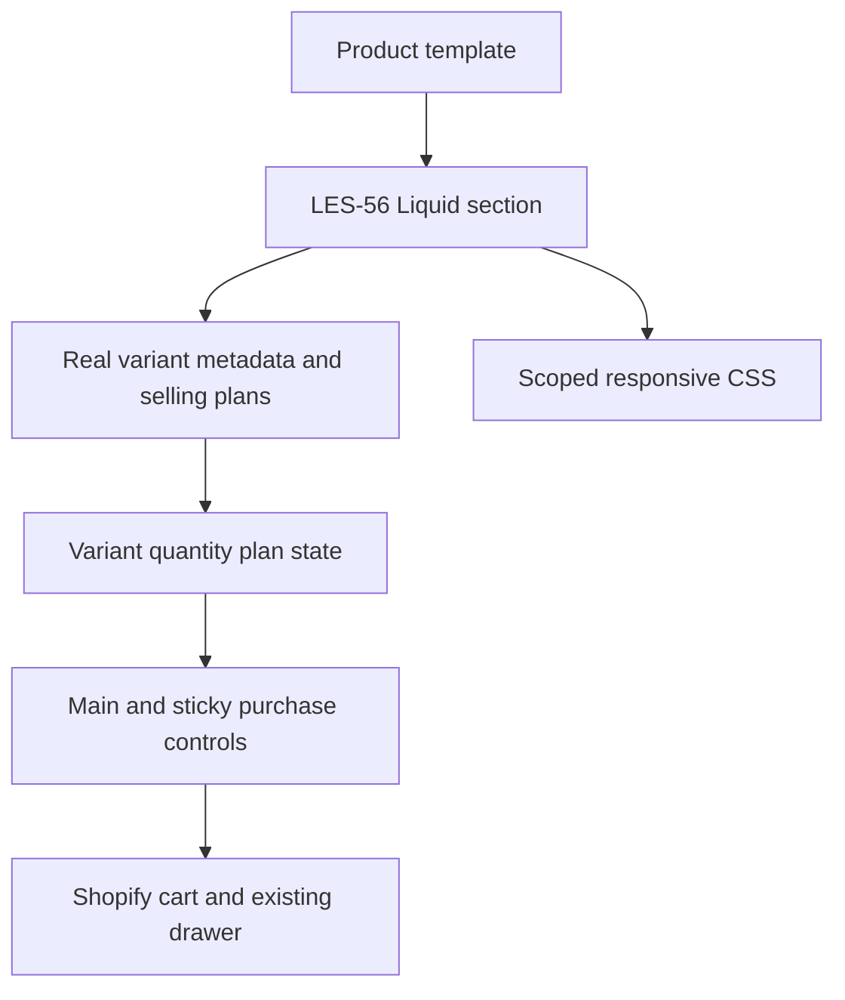
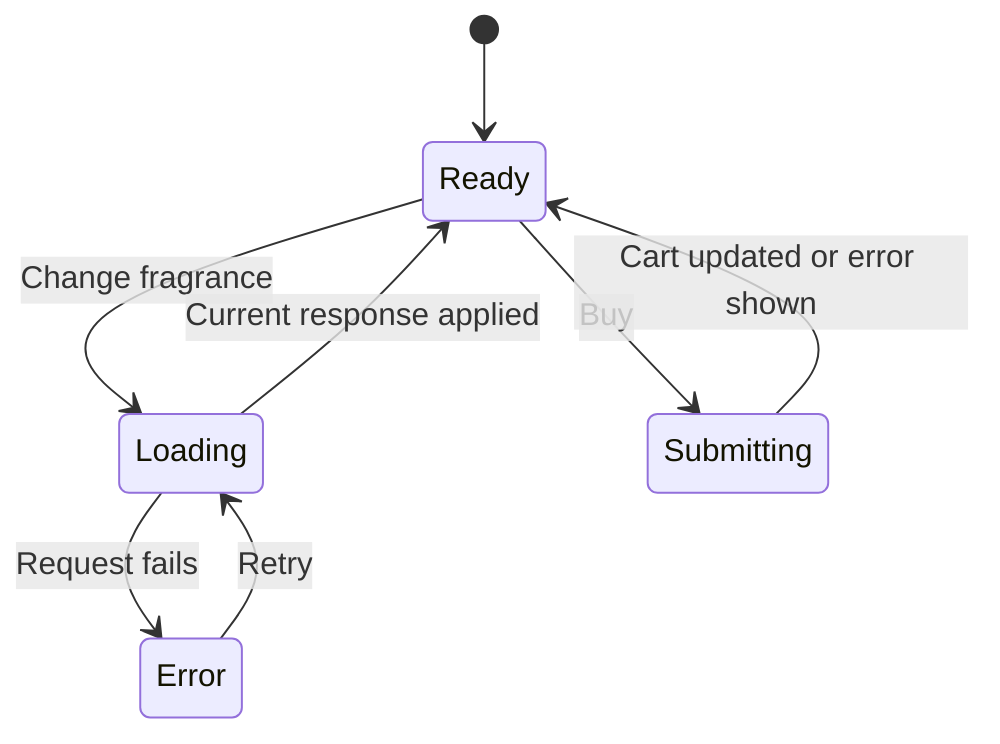

# Fiche produit Figma LES-56 - Plan

## Goal Capsule

- Objective: Visitors can select and buy products through the new mobile and desktop product design, with the visual fidelity specified by the Figma reference.
- Means: Update the most-used assigned product template in the dedicated preview theme (KTD1).
- Authority: User's latest instructions, LES-56, then Figma annotations; real product data and selling plans govern transactional values.
- Execution: Autonomous implementation, visual correction and functional verification; host owns deployment and final review.
- Stop conditions: Missing essential source data or an unresolved conflict that would require altering live shop data; report the exact limitation rather than claiming a pass.
- Delivery: Push refacto/fiche-produit, verify preview theme 186855653754, open a review PR without merging main or dev.

## Product Contract

### Summary

Rebuild the product area through the accordions in the supplied Mobile and Desktop designs. Use real product information, media, variants, quantity discounts and subscription plans in the existing shop.

### Problem Frame

The production theme has the current product layout. The new Figma layout must be implemented without losing the buying behavior or rebuilding the client's integrations in a separate store.

### Key Decisions

- Update the existing most-used product template (session-settled: user-directed — chosen over a new alternate product template: preview the redesign on products already using the template). Governs R1.
- Use the dedicated unpublished theme in the client's store (session-settled: user-directed — chosen over a separate test store: retain products and existing integrations). Governs R2.

### Requirements

**Scope and fidelity**

- R1. Determine the most-used template among storefront-accessible products and list the associated products before changing that template; distinguish this count from unpublished products unavailable to the current access.
- R2. Deploy only refacto/fiche-produit to preview theme 186855653754; keep product assignments and main/dev code unchanged.
- R3. Match the Mobile frame 1:289 (380 px) and Desktop frame 2:1090 (1440 px) of Figma file HWwTV6etAdgQb7AfZ82I8l through the accordions, using their typography, colors, spacing, radii and component order.
- R4. Use actual product media in the gray placeholder slots and actual title, rating, price and variant data in dynamic text slots.
- R5. Keep the existing global header/footer and sections below the accordions; any pre-existing differences outside the requested product area are recorded rather than redesigned.

**Interaction and commerce**

- R6. Provide image zoom, thumbnail selection, thumbnails excluding the active main image, image aspect ratios compatible with the current media, and no gallery arrows on mobile.
- R7. Provide a sticky add-to-cart action on mobile and desktop, with the same selected variant, quantity and selling plan as the main purchase action.
- R8. Show the selected fragrance card outline in the fragrance's color and refresh its real media, title, available quantities, prices and subscription plans.
- R9. Display the subscription bubble text as “-15% toute l'année” for one unit and “-15% supplémentaires” for multiple units, per LES-56; eligibility, actual discounts and prices remain governed by the shop's actual selling plans. Record a visible commercial discrepancy if data contradicts this copy rather than changing discounts.
- R10. Keep add-to-cart payloads, unavailable states, subscription interval choice, cart drawer, app blocks and accordion content correct with real products.
- R11. Match the price shown to the cart's actual selling-plan allocation and quantity totals; do not propagate the historical 2–3 cent discrepancy into the redesigned offer.

### Acceptance Examples

- AE1. Covers R6: selecting a thumbnail makes its image the main image and removes that thumbnail from the visible thumbnail list; closing zoom returns focus to its trigger.
- AE2. Covers R7–R11: selecting fragrance B, quantity 2 and a supported subscription interval then using either purchase action adds exactly those values once to the cart.
- AE3. Covers R8–R10: changing to a fragrance without a previously selected selling plan must use a valid plan for that fragrance or show the available choice before buying.
- AE4. Covers R3: at the two reference widths, product component positions, text styles and dimensions match the design; intermediate widths have no horizontal overflow or occluded controls.

### Scope Boundaries

Live publication, order/payment creation, stock mutations, global app/privacy configuration and merging the separate dev performance branch are outside this change. A preview is a separate theme, not an isolated database.

### Deferred Questions

The gray image slots are placeholders, not assets to reproduce. Mobile and desktop show different fragrance examples and rating numbers; these remain dynamic. If Figma annotations contradict LES-56, preserve the ticket behavior and record the specific discrepancy for the user.

## Planning Contract

### Key Technical Decisions

- KTD1. Inventory assignments using a temporary collection alternate template in the preview, reading product.template_suffix for all paginated storefront products because the available Admin token lacks read_products. Remove this diagnostic template after inventory. This determines R1 without changing product data.
- KTD2. Add a dedicated LES-56 product section and scoped assets, then substitute its type only in the selected existing template. Derive it from the current product contracts rather than altering a shared section used by unrelated templates. Preserve its merchant settings and blocks when compatible.
- KTD3. Use server-rendered Liquid for variant metafields and selling-plan data; use scoped JS for interaction state, section refresh and cart submission. Reuse existing cart drawer integration and app blocks, preventing duplicate purchase listeners.
- KTD4. Keep DM Sans and exact Figma static SVG assets local to the theme. Dynamic product media comes from Shopify. Temporary Figma URLs never ship as runtime sources.
- KTD5. Capture design references and browser screenshots at the same CSS viewport dimensions; compare dynamic slots by geometry and static slots by appearance. Fix in-scope mismatches before claiming completion.

### High-Level Technical Design

### Sources

LES-56 and Figma file HWwTV6etAdgQb7AfZ82I8l are the design authorities. Existing source patterns: sections/cluutch-main-product.liquid, snippets/cluutch-product-variant.liquid, assets/cluutch-main-product.js, assets/cluutch-buy-product.js and templates/product.json. Shopify alternate templates: https://shopify.dev/docs/storefronts/themes/architecture/templates/alternate-templates. Existing deployment reference: main 3ecd6f1, refacto/fiche-produit at the same initial commit; dev performance remains separate.

## Implementation Units

### U1. Inventory the assigned templates

**Goal:** Establish the template and products R1 refers to.
**Requirements:** R1, R2; KTD1.
**Dependencies:** None.
**Files:** templates/collection.les56-inventory.liquid (temporary).
**Approach:** Output a minimal JSON document with storefront product handle, title and template suffix from the all collection, paginated in groups of up to 250. No global layout, customer information or scripts. The host deploys only this diagnostic file to the preview and gathers all pages.
**Test expectation:** None — temporary read-only Liquid diagnostic; verify rendered JSON, pagination and total counts against the public catalogue.
**Verification:** Host obtains the sorted template counts and associated product list with no catalogue mutation.

### U2. Implement the product design and purchasing behavior

**Goal:** Deliver R3–R11 on the template selected by U1.
**Requirements:** R2–R11; KTD2–KTD5; AE1–AE4.
**Dependencies:** U1.
**Files:** sections/les56-main-product.liquid, assets/les56-product.css, assets/les56-product.js, assets/les56-*.svg, the selected templates/product*.json, tests/les56-product.test.mjs; remove templates/collection.les56-inventory.liquid.
**Approach:** Retain dynamic content and block settings while implementing the supplied component structure. Explicitly initialize and tear down gallery/variant state; each selected variant determines its available selling plans. Main and sticky controls share one transactional state. Responsive styles are scoped to the new section. Keep merchant app blocks and existing below-fold sections intact.
**Patterns to follow:** Existing variant metafields and cart drawer event contracts; the host's source research dossier supplies exact boundaries.
**Execution note:** Characterize commerce payloads and stale-response handling before changing interaction behavior; visual-only CSS is verified in browser rather than with implementation-mirroring tests.
**Test scenarios:** Selecting fragrance and quantity preserves the intended cart payload; subscription interval is valid for the active variant; rapid out-of-order fragrance responses cannot overwrite the latest choice; double clicks do not duplicate submissions; failed request permits a visible retry; unavailable variant cannot buy; thumbnail active-image exclusion and zoom focus restoration work.
**Verification:** New behavioral tests pass; Theme Check has no new errors; host confirms deployed Liquid data and exercises real cart flows in the preview.

### U3. Correct visual and functional differences

**Goal:** Resolve implementation discrepancies found on the deployed preview. Preserve and explicitly report the ticket-copy versus actual-selling-plan discrepancy allowed by R9; it remains a deferred merchant decision, while displayed prices and cart totals must still satisfy R11.
**Requirements:** R3–R11; KTD5; AE1–AE4.
**Dependencies:** U2.
**Files:** U2 implementation files and relevant tests only.
**Approach:** Use host screenshots and measured geometry to correct differences against Figma, then repeat the affected checks. Keep dynamic content dynamic and do not move out-of-scope sections to imitate Figma placeholders.
**Test scenarios:** Re-run behavior cases affected by fixes and browser checks at 380, 393, 768, 1024 and 1440 CSS pixels.
**Verification:** Host reviews final screenshots and geometry, validates cart payloads and reports any unverified external flow explicitly.

## Verification Contract

| Gate | Command or method | Done signal |
|---|---|---|
| U1 inventory | Preview collection alternate template, every page | Valid full storefront assignment count |
| Behavioral checks | node --test tests/les56-product.test.mjs plus existing relevant tests | All assertions pass |
| JavaScript syntax | node --check assets/les56-product.js | Exit 0 |
| Theme quality | shopify theme check --path . --output json | No new errors attributable to change |
| Mobile visual | Named agent-browser session, 380/393 px | Reference geometry and static assets match; no overflow |
| Desktop visual | Named agent-browser session, 1440/1024/768 px | Reference geometry and responsive behavior match |
| Commerce | Real anonymous preview cart, single/subscription/quantity/fragrance matrix | Cart ids, quantities, plans and totals agree |
| Deployment | git push, preview theme pull and browser theme id | Deployed files match committed branch, theme 186855653754 |
| Review | ce-simplify-code and independent ce-code-review | Eligible findings fixed |

No order or payment is created. Physical iPhone/Safari and any external flow that cannot be exercised are reported as unverified; these do not substitute for browser checks.

## Definition of Done

The selected existing template renders the requested design on the dedicated preview with correct real product information and working gallery, sticky action, selection, subscription and accordions. All checks above are evidenced, implementation-caused visual deviations are corrected, and abandoned diagnostic/experimental code is removed. Any ticket-copy versus actual-selling-plan discrepancy allowed by R9 is explicitly reported with the verified allocation and remains a deferred merchant decision; it must not be described as commercial consistency or complete fidelity, and displayed prices and cart totals must still satisfy R11. The branch is pushed, a review PR is open without merge, and the user receives preview URLs, screenshots, verified products, remaining questions and material limitations. Never describe a skipped or inconclusive check as a pass.
